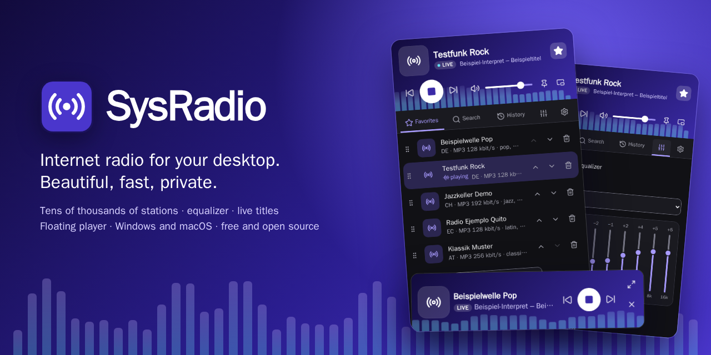
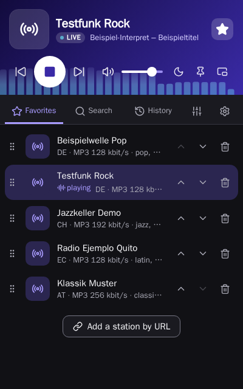
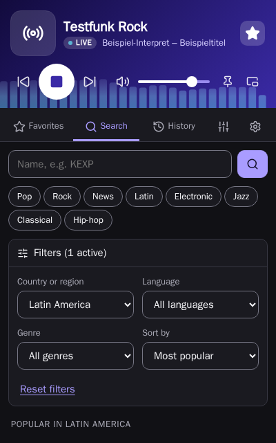
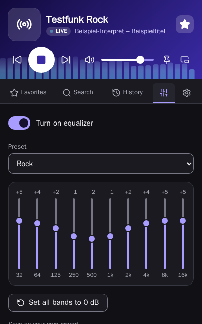
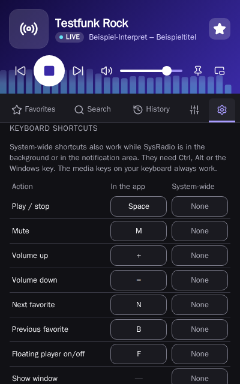
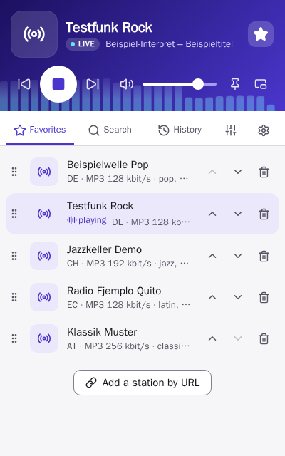
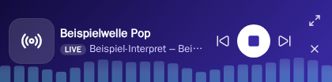

<p align="center">
  
</p>

<p align="center">
  <a href="https://github.com/SysSteve/sysradio/releases/latest"></a>
  
  <a href="LICENSE"></a>
  
</p>

# SysRadio

**Internet radio for your desktop. Beautiful, fast, private.**

Tens of thousands of stations from the free, community-run
[radio-browser.info](https://www.radio-browser.info) directory, in a player that stays out of
your way: it lives in the tray, answers to your media keys, shows what is playing right now and
shapes the sound to your taste. No account, no ads, no tracking.

**[Download for Windows and macOS →](https://github.com/SysSteve/sysradio/releases/latest)**

## A closer look

<table>
  <tr>
    <td width="50%" valign="top">
      
      <h3>Your stations, one click away</h3>
      Live song titles straight from the stream, a spectrum that dances to the music and
      favorites you simply drag into order.
    </td>
    <td width="50%" valign="top">
      
      <h3>Find anything on air</h3>
      Search tens of thousands of stations by name, country, whole regions like Latin America,
      language and genre, and sort by popularity, rating, trend or sound quality. Missing a
      station? Add it by its stream URL.
    </td>
  </tr>
  <tr>
    <td width="50%" valign="top">
      
      <h3>Shape your sound</h3>
      A 10-band equalizer with 12 presets, from Bass boost to Voice, plus your own presets for
      headphones, car or living room.
    </td>
    <td width="50%" valign="top">
      
      <h3>Keyboard first</h3>
      Every shortcut is yours to choose, inside the app and system-wide, so you can skip to
      the next station from any program. Media keys just work.
    </td>
  </tr>
  <tr>
    <td width="50%" valign="top">
      
      <h3>Light or dark</h3>
      Follows your system theme, with high contrast in both. Built and tested for WCAG 2.2 AA:
      fully usable with keyboard and screen reader.
    </td>
    <td width="50%" valign="top">
      
      <h3>The floating player</h3>
      Shrink SysRadio to a tiny always-on-top window and resize it freely: from just a play
      button to a full mini player with volume and spectrum.
    </td>
  </tr>
</table>

## Everything at a glance

- **Find stations:** search by name, country or region (for example Latin America), language
  and genre; sort by popularity, rating, trend or sound quality.
- **Your own stations:** add any stream by URL, including `.pls`, `.m3u` and HLS (`.m3u8`)
  playlists.
- **Favorites and history:** reorder favorites with drag and drop or the keyboard.
- **Now playing:** song titles from the stream, in the window, the tray tooltip and the system
  media overlay.
- **Equalizer:** 10 bands, 12 presets and your own.
- **Animated spectrum** that moves with the music.
- **Floating player:** a small, freely resizable window that stays on top.
- **Keyboard first:** every shortcut can be changed, inside the app and system-wide; media keys
  always work.
- **Tray and autostart:** start at sign-in, close to the tray.
- **Accessible:** built and tested for WCAG 2.2 AA (screen readers, keyboard, contrast).
- **Languages:** English, German, Spanish and French.
- **Private:** SysRadio collects no data. Favorites and settings stay on your device.

## Install

Download the latest installer from
[Releases](https://github.com/SysSteve/sysradio/releases):

- **Windows 10/11:** `SysRadio_x.y.z_x64-setup.exe`. Installs for your user only, no admin
  rights needed. Running a newer installer updates SysRadio in place.
- **macOS 11 or later:** `SysRadio_x.y.z_universal.dmg` (Apple silicon and Intel).

The installers are not code-signed yet. Windows may show "Windows protected your PC": choose
**More info → Run anyway**. On macOS, open the app with right-click → **Open** the first time.
Code signing is planned.

## Build from source

You need [Node.js](https://nodejs.org) 22, [pnpm](https://pnpm.io) and
[Rust](https://rustup.rs), plus the
[Tauri prerequisites](https://v2.tauri.app/start/prerequisites/) for your system.

```bash
pnpm install
pnpm dev            # the UI in a browser, with sample stations
pnpm tauri dev      # the desktop app
pnpm tauri build    # installers in src-tauri/target/release/bundle
pnpm check          # format, types, unit tests
```

Architecture notes (in German) are in [docs/architektur.md](docs/architektur.md).

## How it works

SysRadio is built with [Tauri 2](https://tauri.app) (Rust) and [Svelte 5](https://svelte.dev).
A small proxy inside the app, bound to `127.0.0.1` and protected by a random token, fetches
the streams. It reads the song titles (ICY metadata), makes plain `http` streams and HLS
playable, and lets the equalizer process the audio.

## Contributing

Bug reports, ideas and pull requests are welcome; see [CONTRIBUTING.md](CONTRIBUTING.md).
Security issues: please follow [SECURITY.md](SECURITY.md).

## Credits and license

Station data: [radio-browser.info](https://www.radio-browser.info), a free community project.
Streams come directly from the stations; SysRadio does not host or record anything.

SysRadio is released under the [MIT License](LICENSE). The licenses of the libraries it
includes are shown in the app under Settings → About → Third-party licenses.
